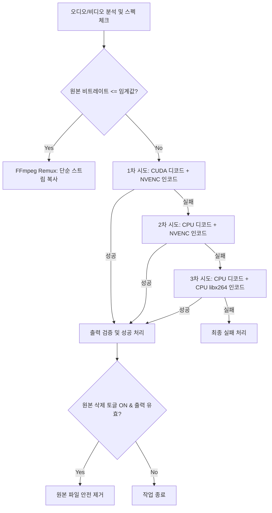

# 🎬 CUDA/NVENC Video Converter (하드웨어 가속 비디오 변환기)

이 프로젝트는 NVIDIA GPU(GeForce RTX 등)의 강력한 하드웨어 가속 기술(**CUDA 디코딩** 및 **h264_nvenc 인코딩**)을 활용하여 대용량 비디오 파일을 초고속으로 변환하고 용량을 다이어트해 주는 윈도우 데스크톱 GUI 프로그램입니다.

기존 `audio_converter` 및 `youtube_down` 프로젝트의 세련된 다크 테마 GUI 톤앤매너를 완벽하게 계승하며, 안정적인 멀티스레드 병렬 인코딩 처리 대시보드를 제공합니다.

---

## 📌 핵심 요구사항 및 기능 설계

### 1. 지능형 비디오 변환 로직
* **NVIDIA 하드웨어 가속 (CUDA / NVENC)**:
  * **디코딩**: `-hwaccel cuda`를 적용해 GPU에서 영상 디코딩을 처리합니다.
  * **인코딩**: `h264_nvenc` 코덱을 사용하여 최소한의 CPU 점유율로 초고속 H.264 인코딩을 수행합니다.
* **이중 폴백 에러 복구 (Double Fallback Mechanism)**:
  * GPU 디코딩 에러(코덱 미지원 등) 발생 시 -> **CPU 디코딩 + GPU 인코딩**으로 자동 전환 시도.
  * GPU 인코딩 자체 에러(VRAM 부족, 10비트 컬러 미지원 등) 발생 시 -> **CPU 디코딩 + CPU 인코딩 (`libx264`)**으로 전환하여 어떤 비디오든 변환이 실패하지 않도록 보장합니다.
* **지능적 단순 복사 (Remux Threshold)**:
  * 비디오 원본의 비트레이트가 설정된 임계값(예: 4 Mbps) 이하인 경우, 재인코딩(화질 손실)을 피하기 위해 화질/오디오 수정 없이 컨테이너만 복사(Remux)하고 스트리밍 최적화 옵션(`-movflags +faststart`)만 적용해 빠르게 저장합니다.
* **해상도 및 음향 한도 자동 스케일링**:
  * 입력 영상이 설정한 해상도(예: 1080p FHD)보다 클 때만 비율을 유지하며 다운스케일링을 수행합니다.
  * 오디오 코덱은 대중적인 `AAC`로 고정하고 비트레이트를 `128 kbps` 수준으로 다운사이징합니다.

### 2. GUI 편의 기능
* **드래그 앤 드롭 파일/폴더 추가**: 대량의 비디오 파일이나 폴더를 통째로 던져 넣어 일괄 추가 가능.
* **동시 변환(병렬) 작업수 조절**: 사용자 GPU VRAM 사양에 맞춰 동시 실행될 백그라운드 인코딩 개수(1~8개)를 슬라이더로 조절.
* **진행 후 원본 삭제 토글**: 인코딩 및 출력 파일 크기 유효성 검증 완료 시, 저장 공간 확보를 위해 원본 비디오 파일을 안전하게 영구 자동 삭제 처리.
* **실시간 멀티 대시보드**: 진행 중인 N개의 개별 비디오 파일의 배속(speed) 정보와 실시간 퍼센트 프로그레스바를 개별적으로 표시.

---

## 🔄 시스템 변환 및 폴백 흐름도



---

## 🎨 GUI 시안 구성

```
+-----------------------------------------------------------------------+
|  CUDA/NVENC Video Converter v1.0.0                               [X]  |
+-----------------------------------------------------------------------+
|  [ 드래그 앤 드롭 영역: 파일 또는 폴더를 여기에 끌어다 놓으세요 ]      |
|                                                                       |
|                     [파일 추가...]    [폴더 추가...]                  |
+-----------------------------------------------------------------------+
|  동시 변환 개수: [========o=======] 4개  (VRAM 12GB+ 권장)            |
|  최대 비디오 대역폭(Bitrate): [ 3.5 Mbps v ]   오디오: [ 128 kbps v ]  |
|  해상도 제한: [ 1080p (FHD) v ]    [x] 완료 후 원본 파일 자동 삭제    |
|                                                                       |
|  저장 위치: (o) 원본 폴더   ( ) 지정 폴더: [ C:\Output_Video   ] [변경]|
|  파일명 옵션: ( ) 덮어쓰기  (o) 접미사: [ _cuda ]  ( ) 접두사          |
+-----------------------------------------------------------------------+
|  [ 현재 실행 중인 변환 작업 ]                                          |
|  1. Movie1.mkv : [=====================>           ] 65% (speed: 3.4x) |
|  2. Video2.mp4 : [=========>                       ] 30% (speed: 2.1x) |
+-----------------------------------------------------------------------+
|  [ 대기열 목록 (5개 대기 중) ]                                         |
|  파일명                 | 원본 크기 | 설정 해상도 | 상태              |
|  -------------------------------------------------------------------  |
|  03. Lecture.ts         | 4.2 GB    | 1080p       | 대기              |
|  04. Vlog.mov           | 800 MB    | 1080p       | 대기              |
+-----------------------------------------------------------------------+
|  전체 진행률: [=============>                         ] 35% (2/5)     |
|                                               [변환 시작] [대기열 비우기] |
+-----------------------------------------------------------------------+
```

---

## 🚀 개발 로드맵

1. **Phase 1: CLI 코어 구현 및 비동기 파싱**
   * ffprobe 정보 획득 구현.
   * ffmpeg `stderr` 출력으로부터 `time=` 및 `speed=` 문자열을 파싱해 진행 상황을 비동기로 추출하는 모듈 검증.
   * CUDA -> CPU 디코드 -> CPU 인코드 단계별 폴백 프로세스 구현.
2. **Phase 2: GUI 뼈대 및 멀티 프로세스 관리 통합**
   * CustomTkinter UI 레이아웃 빌드.
   * `ThreadPoolExecutor`를 활용해 동시 인코딩 개수만큼 스레드를 구동하고, 개별 진행 뷰어 위젯 동적 연동.
   * 드래그앤드롭 이벤트 및 원본 파일 자동 삭제 검증.
3. **Phase 3: 런처/배포 최적화**
   * PyInstaller 빌드 배포판 작성 및 검증.
